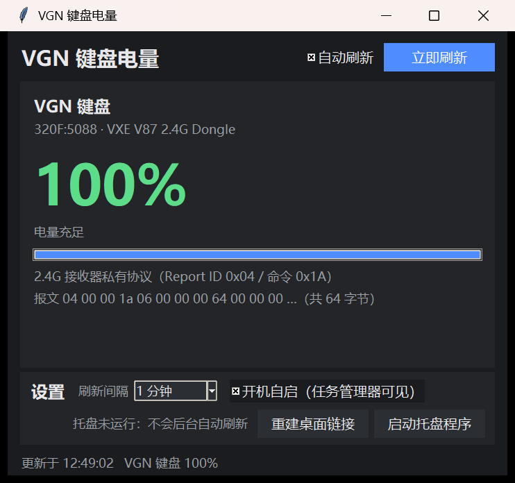

# VGN 键盘电量（Windows 10/11 · 纯 ctypes · 零第三方依赖）

显示 **VGN / VXE 2.4G 无线键盘**电量的三合一工具：简洁面板、托盘常驻、完整调试版。
只用 Python 标准库 + ctypes（GUI 用 tkinter），不装 hidapi / Pillow / pywin32。



## 你的设备已经对上了

| 设备 | VID:PID | 通道 | 结论 |
|---|---|---|---|
| VGN / VXE 无线键盘（2.4G 接收器） | `320F:5088` | usage page `0xFF1C`，64 字节输入/输出，Report ID `0x04` | 本机实测读通，电量 = 回包第 8 字节 |

本机实测报文（100% = 0x64，第 9 字节 0x00 = 未充电）：

```
发: 04 00 00 1A 06 00 00 00 00 ... 00   (64 字节)
收: 04 00 00 1A 06 00 00 00 64 00 ...   (64 字节)
              ^^ 命令 0x1A=GetBatteryLevel      ^^ 电量  ^^ 充电标志
```

## 下载（不想装 Python）

到 [Releases](https://github.com/yangyuuuuu/vgn-battery/releases) 下载
`VGN-Keyboard-Battery-v1.0.0.exe`，双击就能用（单文件，不用装 Python）：

* 双击 → 打开简洁面板
* `VGN键盘电量.exe --tray` → 托盘常驻（也可在面板里点「启动托盘程序」）
* `VGN键盘电量.exe --quit` / `--status` / `--once` → 退出托盘 / 看状态 / 命令行读一次

> exe 是 PyInstaller 打包的免安装单文件，Windows Defender / 国产杀软偶尔会因为它
> 「没有签名」报可疑；源码就在本仓库，介意的话直接跑 Python 版本（下面）。

## 怎么用

```console
python my_devices.py               # 简洁面板（默认 60 秒自动刷新）
python my_devices.py --once        # 命令行读一次就退出
python tray_app.py --debug         # 托盘前台运行并打印过程（排查用）
python app.py                      # 完整调试版：枚举接口 / 转储 Feature Report / 探测 Report ID / 手动标定
```

桌面上的入口是**软连接**（不是副本）：

* `VGN键盘电量` → 目录链接（真符号链接优先，权限不足自动降级 junction）
* `VGN键盘电量.bat` / `键盘电量托盘.bat` → 文件链接（符号链接，降级硬链接）

托盘操作：**左键**立刻刷新一次；**右键**打开/前置简洁面板；**悬停**看 VGN 键盘：100%（更新时间）。

开机自启 = 「启动」文件夹里的 `键盘电量托盘.lnk`（任务管理器 →「启动」标签里能看到、能禁用），
目标为 `pythonw.exe` + `tray_app.py`，不弹黑窗。面板勾选框和任务管理器读的是同一份真实状态。

## 协议说明（已验证，不用再逆向）

```
接口   usage page 0xFF1C（厂商自定义），输入 64 / 输出 64 字节，无 Feature Report
Report 只有 Report ID 0x04 这一条可写报文
请求   04 00 00 1A 06 00 00 00 + 补 0 到 64 字节
回复   04 00 00 1A 06 00 00 00 <电量> <充电> ...
       回包 len > 9 且 r[3] == 0x1A 才算电量回包，随后 r[8] = 百分比（0-100），r[9] != 0 = 充电中
```

踩过的坑（都规避掉了）：

1. **必须用 `WriteFile` 发 Output Report。** `HidD_SetOutputReport` 在这颗 Telink 接收器上
   会返回成功，但数据其实没进设备，永远等不到回包。
2. 键盘空闲会休眠，接收器收不到回包；第一次查询常被当作唤醒吞掉，所以在一段时间内重发几次，
   并把「敲一下键盘再刷新」写进提示。
3. 收发必须用**两个句柄**：读用独立的 `FILE_FLAG_OVERLAPPED` 句柄 + 事件超时 + `CancelIoEx`，
   绝不在同一句柄上边阻塞读边写（实测会直接把进程干掉，连异常栈都没有）。
4. tkinter 不是线程安全的：后台线程只往 `queue.Queue` 放结果，主线程 `after(1000, pump)` 取。
5. 销毁托盘窗口必须在 `WM_DESTROY` 里 `PostQuitMessage(0)`，否则留下「窗口没了、图标没了、
   进程还活着还占着单实例锁」的僵尸进程。
6. 不做 DPI 声明图表和字会发糊 —— 托盘和面板都调了 `SetProcessDPIAware`。

## 文件说明

| 文件 | 说明 |
|---|---|
| `vgn_proto.py` | **键盘电量协议**（本机验证过的唯一权威实现）：百分比 / 充电标志 / 原始报文 |
| `my_devices.py` | 简洁面板（单张卡片） |
| `tray_app.py` | 托盘常驻（`Shell_NotifyIconW` + `SetTimer`，图标就是电量数字，空闲不占 CPU） |
| `app.py` | 完整调试版：枚举 HID、转储报告、探测 Report ID、手动标定（存 `protocols_user.json`） |
| `hid_win.py` | HID 底层（setupapi / hid 的 ctypes 封装） |
| `battery.py` | 通用策略层（标准电量字段 → 厂商协议表 → 罗技 HID++ → 手动标定），已收录本键盘协议 |
| `tray_common.py` | 配置 / 开机自启 / 桌面链接 / 进程间消息 |
| `win_icon.py` `win_link.py` `win_shell.py` | 点阵数字→ICO、软链接降级、已知文件夹与 .lnk |

## 实测验收

| 项目 | 结果 |
|---|---|
| `python my_devices.py --once` | 通过：`VGN 键盘: 100%`（连读 8 次 8/8 成功） |
| 面板百分比 / 颜色 / 进度条 | 通过：见上图（≥60 绿 / 30–59 黄 / <30 红） |
| 任务管理器「启动」可见并可禁用 | 通过：`键盘电量托盘.lnk`，状态与勾选框一致 |
| 桌面是链接不是副本 | 通过：目录 + 两个文件全是真符号链接 |
| 项目目录不产生日志 | 通过：只有 `tray_config.json`（设置，不是日志） |
| 连启停托盘 3 次 | 通过：3/3 正常，退出后无窗口、无残留进程、无残留图标 |
| 空闲 CPU | 通过：40 秒内 0.000 秒 CPU，内存 24 MB |

## 常见问题

* **显示「键盘没有回复」**：键盘在省电休眠。敲一下键盘，再点「立即刷新」；并确认键盘开关在
  2.4G 档、接收器插好。
* **一直 100%**：这就是键盘上报的值（接收器直接转发键盘固件的电量）；插上充电线再看，
  第 9 字节变非 0，界面显示「充电中」。
* **换了别的型号/品牌**：先用 `python app.py` 打开完整调试版，枚举接口、转储报文、手动标定；
  标定过的协议存进 `protocols_user.json`，下次自动生效。协议彻底变了就改 `vgn_proto.py`
  里的 `CMD_BATTERY` 和 `IDX_*` 常量。
* **不想开机自启**：面板里取消勾选，或 `python my_devices.py --autostart off`。

## 自己打包 exe

```console
build.bat
```

会建一个 `.venv-build` 虚拟环境、装 PyInstaller、生成 `docs/icon.ico`，最后产出
`dist\VGN键盘电量.exe`。**PyInstaller 只在打包时用**，打出来的 exe 运行时依然
只有标准库 + ctypes。

## 许可证

本仓库作者编写的部分（`vgn_proto.py` / `my_devices.py` / `tray_app.py` / `launcher.py` 等）为 MIT；
Windows 底层件沿用自 [yszyszysz233/2.4G-battery-viewer](https://github.com/yszyszysz233/2.4G-battery-viewer)，
该上游未声明许可证，权利归原作者。详见 [LICENSE](LICENSE) 与 [NOTICE.md](NOTICE.md)。

## 来源

工程骨架和「用 Agent 摸协议」的方法来自 [yszyszysz233/2.4G-battery-viewer](https://github.com/yszyszysz233/2.4G-battery-viewer)
（读 ATK 鼠标 + 杰理耳机的社区工具）。本目录按 VGN 键盘重做了设备层：单卡片面板、单图标托盘、
新的 `vgn_proto.py`，并补掉了原 prompt 没提到的两个坑（`HidD_SetOutputReport` 假成功、DPI 声明）。
协议细节由本机实测 + 对 VGN 官方 HUB 的兼容性分析得到，仅供学习与个人使用。
